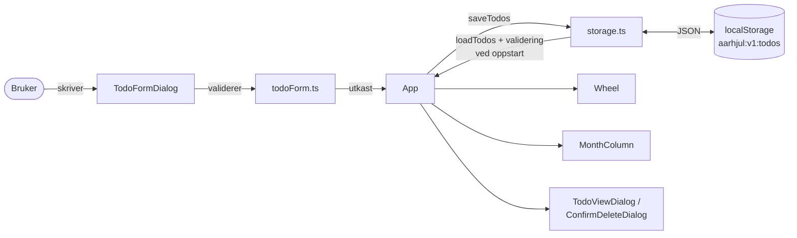

# Arkitektur – Aarhjul

## Oversikt

Aarhjul er et årshjul for faste gjøremål som kommer igjen hvert år. Brukeren legger inn et gjøremål med én til tolv datoer. Gjøremålet vises som én prikk per dato på et sirkulært hjul, og som et kort i sidekolonnen hvis det har en dato i inneværende måned. Kravene står i [`docs/krav/aarshjul.md`](krav/aarshjul.md) og designet i [`docs/design/`](design/).

Appen kjører bare i nettleseren. Den har ingen server, ingen innlogging og ingen nettverkskall. Gjøremålene lagres i nettleserens `localStorage`. Appen er en statisk side på GitHub Pages: `https://aarola2.github.io/Aarshjul/`.



Hovedflyten:
1. `App` leser lagringen én gang ved oppstart (`loadTodos`). Er dataene gyldige, blir de tilstanden. Er de ødelagte, starter appen med en tom liste, tar vare på en kopi og viser en melding.
2. Brukeren fyller ut skjemaet. `todoForm.ts` validerer tittel, beskrivelse og datoer og gir enten et utkast eller feilmeldinger per felt.
3. `App` lagrer først og oppdaterer tilstanden etterpå. Hjulet og sidekolonnen viser derfor aldri noe som ikke er lagret.
4. Hjulet og sidekolonnen tegnes ut fra tilstanden og dagens dato (`useToday`).

## Deler

All kode ligger i `frontend/src`. Testene ligger ved siden av koden (`*.test.ts(x)`).

| Modul | Ansvar |
|---|---|
| `main.tsx` | Starter React i `#root`. |
| `App.tsx` | Eier tilstanden: gjøremålene, hvilken dialog som er åpen, og meldingen om ødelagte data. Lagrer gjennom `storage.ts`. |
| `Wheel.tsx` | Tegner hjulet som SVG: måneder i årstidsfarger, dagsstreker, datotall, ringen rundt dagens dato og prikkene. Prikkene er knapper med opplesbar tekst («Tittel, 15. mai»). |
| `wheelGeometry.ts` | Månedene, årstidene og geometrien til hjulet, for eksempel vinkel per dag. Januar ligger øverst, og månedene går med klokken. |
| `dotPlacement.ts` | Plasserer prikkene langs datolinjen. Startplassen utledes av en hash av id-en (FNV-1a), så plasseringen er lik hver gang. Den sjekker at to prikker aldri overlapper. |
| `MonthColumn.tsx` | Sidekolonnen «Denne måneden»: ett kort per gjøremål, eller tomtilstanden. |
| `monthList.ts` | Finner gjøremålene i en måned og sorterer dem etter første dato. |
| `DateBadge.tsx` | En dato i årstidsfarge. Dagens dato er merket. 29. februar vises 28. februar i år uten skuddår. |
| `TodoFormDialog.tsx` | Skjemaet for å opprette og redigere: tittel, beskrivelse og 1–12 datofelt, med tekst (dd.mm) eller nettleserens datovelger. |
| `todoForm.ts` | Ren logikk for skjemaet: tolker og validerer datoer og lengder, lager nye gjøremål (ny id med `crypto.randomUUID()`, som ikke kolliderer med en id som finnes), og oppdaterer og fjerner gjøremål. |
| `TodoViewDialog.tsx` | Viser ett gjøremål, med knapper for Rediger og Slett. |
| `ConfirmDeleteDialog.tsx` | «Er du sikker?» før sletting. «Avbryt» har fokus, så et feiltrykk på Enter ikke sletter. |
| `useModalDialog.ts` | Felles oppførsel for dialogene: åpnes modalt, Esc lukker, og fokus går tilbake dit brukeren kom fra. |
| `CorruptDataAlert.tsx` | Meldingen om ødelagte data, med knapp for å laste ned kopien. |
| `storage.ts` | Datamodellen (`Todo`, `TodoDate`), nøklene og grensene, og lesing, lagring og validering av alt som leses fra `localStorage`. |
| `useToday.ts` | Dagens dato fra nettleseren. Den oppdateres ved midnatt og når fanen blir synlig igjen. |

**Datamodell.** Et gjøremål har `id`, `title` (1–60 tegn), `description` (0–500 tegn), `dates` (1–12 unike `{ month, day }`) og `createdAt` (ISO-tidsstempel). Det finnes ikke noe år, for alt gjentas hvert år. 29. februar lagres som det er og vises 28. februar i år uten skuddår.

**Nøkler i `localStorage`.** Nøklene har prefikset `aarhjul:v1:`, fordi alle Pages-sider under `aarola2.github.io` deler opprinnelse:
- `aarhjul:v1:todos`: listen med gjøremål.
- `aarhjul:v1:corrupt-copy`: kopi av ødelagte data. Den skrives bare når dataene var ødelagte, og `saveTodos` skriver aldri dit.

## Kjøre

**Lokalt**, fra `frontend/`:

```sh
npm ci
npm run dev        # http://localhost:5173/Aarshjul/
npm run build      # typecheck + bygg til dist/
npm run preview    # serverer dist/ på http://localhost:4173/Aarshjul/
```

`base: '/Aarshjul/'` i `vite.config.ts` gjør at stiene stemmer med GitHub Pages.

**Utrulling** (`.github/workflows/deploy.yml`) starter når CI er grønn etter en push til `main`. Tagger og releaser starter ingen kjøring.

1. **`bygg`**: bygger `dist/` én gang, laster opp artefakten og regner ut sha256-digesten.
2. **`staging`**: laster ned *den samme* artefakten, sjekker digesten, pakker den ut til `dist/` og kjører hele e2e-pakken mot den (`E2E_PREVIEW=1`).
3. **`produksjon`**: publiserer den samme artefakten til GitHub Pages etter en ny digest-sjekk. Ingenting bygges på nytt mellom miljøene.

Produksjon er stengt (fail closed) på to måter:
- Jobben kjører bare når repo-variabelen `PRODUKSJON_GODKJENNING_VERIFISERT` er `true`.
- Miljøet `production` krever godkjenning fra eieren (required reviewers). Administratorer kan ikke omgå det, og bare `main` er tillatt.

> Viktig rekkefølge: GitHub lager et miljø automatisk første gang en jobb bruker det. Lag derfor `production` med beskyttelse *før* variabelen settes. Ellers kan første kjøring publisere uten godkjenning.

Et slipp lages med `/slipp-til-produksjon <versjon>`. Det tagger commiten som allerede står og venter i `produksjon`. Eieren godkjenner under Actions → Deploy → Review deployments.

## Teste

Kommandoene kjøres fra `frontend/`.

| Nivå | Verktøy | Kommando | Hva |
|---|---|---|---|
| Enhet og komponent | Vitest + Testing Library (jsdom) | `npm test`, `npm test -- --coverage` | Logikk og komponenter, ved siden av koden. Dekningsgrensen er 80 % (linjer, grener, funksjoner, setninger), satt i `vite.config.ts`. |
| Ende-til-ende | Playwright (Chromium) | `npm run e2e` | Brukerflyter mot utviklingsserveren. Én test per akseptkriterium i UI-issuene. Skjermbilder i `playwright-report/`. |
| E2E mot bygget | Playwright | `npm run build` + `E2E_PREVIEW=1 npm run e2e` | Den samme pakken mot `dist/` med `vite preview`. Brukes av `staging`. |
| Statisk | ESLint (strictTypeChecked), TypeScript (strict) | `npm run lint`, `npm run typecheck` | Kodestil og typer. |

I e2e-testene velges elementer med `getByRole`/`getByLabel`/`getByText`. Klokka låses med `page.clock.setFixedTime`, og siden åpnes med relative stier (`page.goto('./')`).

**CI** (`.github/workflows/ci.yml`) kjører på hver PR og hver push til `main`:
- **`kontroll`**: lint, typecheck, tester med dekning, og build.
- **`avhengigheter`**: `npm audit --audit-level=high`.
- **`hemmeligheter`**: gitleaks over hele historikken.
- **`kodeanalyse`**: CodeQL for JavaScript/TypeScript og for Actions.
- **`e2e`**: Playwright, med rapporten som artefakten `playwright-rapport`.

## Feilsøke

| Symptom | Årsak og hva du gjør |
|---|---|
| Meldingen «Lagrede data var ødelagt» | Innholdet i `aarhjul:v1:todos` besto ikke valideringen i `storage.ts`. Last ned kopien fra meldingen, eller les `aarhjul:v1:corrupt-copy` i utviklerverktøyene (Application → Local Storage). |
| Hvit side og feil i konsollen om `localStorage` | Nettleseren blokkerer lagring for nettstedet, og appen håndterer ikke det ennå (#46). Tillat nettstedsdata for adressen. |
| Endringer forsvinner når appen er åpen i to faner | Den siste fanen som lagrer, overskriver den andre (#47). Bruk én fane. |
| Lokal e2e gir rare resultater | `reuseExistingServer` er på lokalt, så Playwright gjenbruker det som allerede kjører på port 5173. Sjekk med `lsof -nP -iTCP:5173 -sTCP:LISTEN`, og stopp den andre serveren. |
| En e2e-test feiler bare på visse datoer | Testen bruker dagens dato uten å låse klokka. Bruk `page.clock.setFixedTime`. |
| `produksjon` står som skipped | Variabelen `PRODUKSJON_GODKJENNING_VERIFISERT` er ikke `true`, eller navn og verdi er byttet om. |
| `produksjon` står som «Waiting for review» | Riktig: sperren venter på godkjenning fra eieren. |
| `staging` feiler på «Verifiser digest» | Artefakten er endret mellom `bygg` og `staging`. Ikke publiser. Kjør utrullingen på nytt fra en ny commit på `main`. |

## Sikkerhet og trusselmodell

**Data og personvern.** Det eneste som lagres, er det brukeren selv skriver (titler, beskrivelser og datoer), og bare i brukerens egen nettleser. Ingenting sendes noe sted. Appen samler ikke inn personopplysninger, men brukeren bør ikke legge sensitive opplysninger i beskrivelsen (se delt opprinnelse under).

**Aktører**
- **Brukeren**, som bruker appen i egen nettleser på PC.
- **Andre sider på `aarola2.github.io`.** De deler opprinnelse med appen, og dermed `localStorage`.
- **Avhengigheter og forsyningskjeden**: npm-pakker (React i produksjon, verktøy i utvikling) og GitHub Actions.
- **De som kan pushe til repoet.** Endringer skal gå via PR til `main`. Rulesettet og de påkrevde sjekkene håndheves i GitHub-innstillingene, som eieren kontrollerer. De står ikke i repoet. Produksjon krever godkjenning fra eieren.

**Tillitsgrenser og angrepsflater**

| Grense | Tiltak |
|---|---|
| `localStorage` → appen | Alt som leses er ubetrodd. `storage.ts` sjekker nøyaktige nøkler, typer, lengder, gyldige datoer, unike id-er og datoer, og ISO-tidsstempel. Ugyldige data brukes ikke. Appen starter tomt, tar vare på en kopi og viser en melding. |
| Skjemaet → appen | `todoForm.ts` validerer lengde og dato før noe lagres. Tekst vises bare gjennom React, som escaper den. Appen bruker ikke `dangerouslySetInnerHTML`, `innerHTML` eller `eval`. |
| Nedlasting av ødelagte data | Kopien lastes ned som Blob med fast filnavn (`aarshjul-odelagte-data.json`) og typen `application/json`. Innholdet vises aldri på siden. |
| Bygg og CI | Actions er festet til full SHA. Arbeidsflytene har `permissions: contents: read` som standard. Det finnes ingen `pull_request_target`. `persist-credentials: false`. gitleaks, CodeQL, `npm audit` og Dependabot. |
| Utrulling | Én artefakt med digest-sjekk mellom miljøene. Produksjon er stengt med variabel og required reviewers. |

**Godtatte risikoer**
- **Delt opprinnelse.** Alle Pages-sider under `aarola2.github.io` kan lese, endre og slette `aarhjul:v1:*`. Et eventuelt rotrepo `aarola2.github.io` kan i tillegg registrere en service worker for hele opprinnelsen. Prefikset hindrer bare at nøkler kolliderer ved et uhell. Det er ingen sikkerhetsgrense. Risikoen er godtatt fordi bare eieren kan publisere på opprinnelsen og dataene er lite sensitive. Et eget domene er løsningen hvis det blir behov.
- **Clickjacking.** GitHub Pages kan ikke sette `X-Frame-Options` eller `frame-ancestors`, og de virker ikke i en meta-tag. Moderne nettlesere deler opp lagringen for innrammede sider fra andre nettsteder, så en side som rammer inn appen, ser ikke brukerens data.

**Åpne risikoer** (har egne issues)
- Appen har ingen Content-Security-Policy (#45).
- Lagring som er blokkert eller full, håndteres ikke (#46).
- Endringer fra andre faner overskrives (#47).
- Dependabot har ingen ventetid før nye versjoner (#49).

**Ikke relevant, og hvorfor**
- **Autentisering, autorisasjon per rolle, IDOR/BOLA:** Det finnes ingen innlogging, ingen roller og ingen ressurser på en server.
- **Injeksjon mot server eller database, og rate limiting:** Appen har ingen server, ingen database og ingen API-kall.
- **Logging av sensitive data:** Appen logger ikke. Produksjonsbygget har ingen sourcemaps.
- **Hemmeligheter i appen:** Appen trenger ingen. Den eneste hemmeligheten i CI er `GITHUB_TOKEN`, som Actions lager selv.
